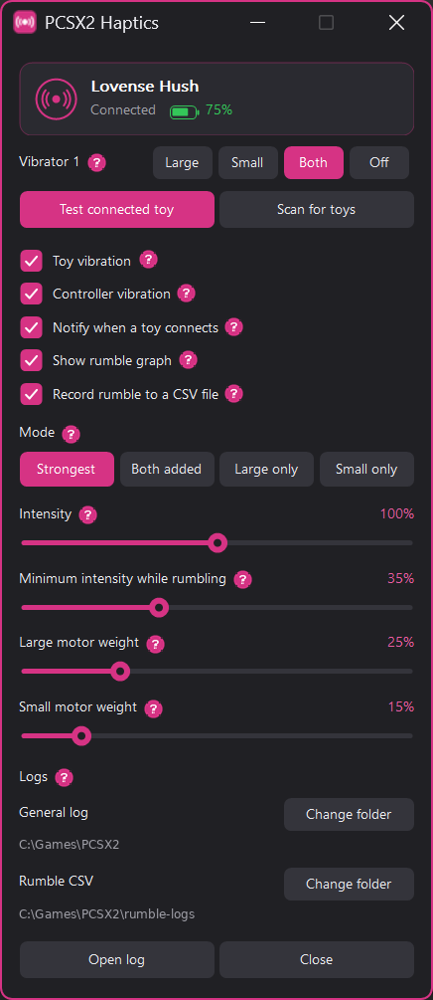
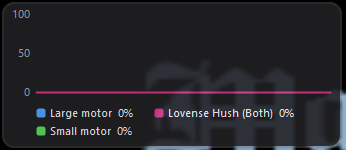

# PCSX2 Haptics

> **Adults only (18+).** This mod controls sex toys. It is an independent project, not affiliated with PCSX2, Lovense, or Nonpolynomial (Buttplug/Intiface).

PCSX2 Haptics sends PlayStation 2 controller rumble to Bluetooth toys, in any game that rumbles. Your gamepad keeps vibrating as usual (unless you turn that off), and each toy vibrator gets the same rumble.

It works with any toy supported by [Buttplug / Intiface](https://buttplug.io) (most Lovense toys and many others). It was developed and tested with a Lovense Hush.

<p align="center">
  
  &nbsp;&nbsp;
  
</p>

## Features

- **No emulator changes or controller setup.** Works with PCSX2's SDL (default) and XInput controller sources.
- **Starts and stops with PCSX2.** A bundled, hidden Intiface Engine is launched with the emulator and closed with it. If Intiface Central is already running, it is used instead.
- **Tray icon:** left click opens the settings, right click opens a quick menu.
- **A card per connected toy** shows its battery and a pencil to give it a name, so two toys of the same model can be told apart.
- **Vibrator mapping:** choose what drives each toy vibrator: the large motor, the small motor, both, or nothing. It is saved per toy.
- **Live tuning:** intensity, minimum intensity, per-motor weights and how the two motors combine. Only the settings that affect your mapping are shown, and a warning appears if a combination would leave the toy stuck at one level.
- **Rumble graph overlay:** a small always-on-top graph of the controller motors and each toy vibrator. You can drag it, resize it and hide it.
- **Rumble CSV recording**, with ISO 8601 timestamps, to look at a session in a spreadsheet.
- **Notifications** when a toy connects, disconnects or runs low on battery.
- **Self-repair** when Windows' Bluetooth refuses a toy that it can see, plus a clean engine shutdown so toys reconnect next time.

## Requirements

- Windows 10 or 11 (64-bit), with Bluetooth LE (or a Lovense USB dongle, see [Settings](#settings)).
- PCSX2 2.x (the Qt version). Tested with PCSX2 v2.9.
- A toy supported by Intiface. Check [IOSTIndex](https://iostindex.com) for your model.

## Install

1. Download the latest `PCSX2-Haptics-x.y.z.zip` from [Releases](../../releases).
2. Extract it into the folder that contains `pcsx2-qt.exe`.
3. Turn on Bluetooth and your toy. Don't pair it in Windows' Bluetooth settings, and disconnect it from other apps such as Lovense Remote or Connect: a toy only accepts one connection at a time.
4. Start PCSX2. A pink icon appears in the system tray, and a notification shows when the toy connects.

**To uninstall,** delete `version.dll` from the PCSX2 folder.

## Using it

| Where | What |
| --- | --- |
| Tray icon, left click | Settings window. Resize it to zoom everything. |
| Tray icon, right click | Quick menu: toggles, intensity presets, mode, scan, test, restart server. |
| Pink **?** icons | An explanation of every option. |
| Notification, click | Opens the settings. The **x** closes it. |
| Graph | Drag to move, drag the bottom-right corner to resize, right-click to hide. |

### Vibrator mapping

A PS2 controller has two motors: a **large** one for heavy rumble (explosions, crashes) and a **small** one for a quick buzz. Many games only use the large one. For each toy vibrator you can pick:

- **Large / Small:** follows that motor.
- **Both:** both motors combined according to **Mode** (*Strongest*, *Both added*, *Large only*, *Small only*).
- **Off:** that vibrator isn't used.

By default, single-vibrator toys use *Both*, and two-vibrator toys put *Large* on the first vibrator and *Small* on the second.

## Settings

Everything is stored in `pcsx2-haptics.ini` next to PCSX2. If that folder is read-only (for example under `Program Files`), it goes to `%APPDATA%\PCSX2 Haptics\` instead. Most values are set from the settings window; a few are only in the file:

| Key | Default | Meaning |
| --- | --- | --- |
| `[Intiface] AutoStartServer` | `1` | Start the bundled engine when no Intiface server is running |
| `[Intiface] Port` | `12345` | Intiface WebSocket port |
| `[Intiface] ServerArgs` | *(empty)* | Extra engine arguments, for example `--use-lovense-dongle-hid` for the Lovense USB dongle |
| `[Haptics] Controller` | `0` | Controller slot to follow (`-1` = any) |
| `[Haptics] UpdateIntervalMs` | `60` | How often toys are updated |
| `[Debug] LogRumble` | `0` | Log every rumble change and server message |

Per-toy settings are kept in `[Toy <bluetooth address>]` sections (name and vibrator mapping).

## Troubleshooting

- **The toy is found but never connects.** Windows' Bluetooth can get stuck holding an old connection. Turn the toy off and on, then turn Bluetooth off and on in Windows Settings. The mod also restarts its engine on its own when this happens.
- **Nothing in the tray.** Check that `version.dll` is next to `pcsx2-qt.exe`. Then look in `pcsx2-haptics.log` for the line `XInput hooked, SDL rumble hooked, ...`.
- **The toy doesn't react in a game.** Turn on the rumble graph. If the blue and green lines stay flat, the game (or your controller binding) isn't sending rumble. If they move but the pink line doesn't, check the vibrator mapping and the amber warning under the sliders.
- **Notifications or the graph don't show over the game.** Exclusive fullscreen hides other windows. In PCSX2, set *Graphics → Display → Allow Exclusive Fullscreen* to *Disabled*.
- Logs: **Open general log** in the settings window, or `pcsx2-haptics.log` and `intiface-engine.log` in the log folder.

## Antivirus warnings

To get into PCSX2 without modifying it, the mod uses techniques that some antivirus software flags: it is named like a Windows DLL (`version.dll`), patches PCSX2's import table in memory to catch the rumble calls, and starts a hidden helper process (Intiface Engine). Nothing is sent anywhere except to the local Intiface server on `127.0.0.1`.

Release builds are produced by GitHub Actions from this repository's source, so you can check what you run. If your antivirus flags the file, you can report it as a false positive.

## How it works

- `version.dll` forwards every Windows `version.dll` function to the real one in System32. PCSX2 imports that DLL, so Windows loads this one first from PCSX2's folder.
- A startup thread patches `pcsx2-qt.exe`'s import table so that `SDL_RumbleGamepad` (plus SDL's haptic rumble fallbacks) and the `XInputSetState` handed out by `GetProcAddress` go through the mod first, then on to the real functions.
- The rumble goes to Intiface over its WebSocket using the Buttplug protocol (v3). Battery levels come back the same way. Toys are identified by the Bluetooth address that the engine logs when it registers a device.

Source layout:

| File | Purpose |
| --- | --- |
| `src/version_proxy.c` | `version.dll` forwarding and startup |
| `src/hooks.c` | XInput and SDL3 rumble hooks |
| `src/bridge.c` | Intiface connection, engine process, motor mapping, battery, CSV, settings |
| `src/ui.c` | Tray icon, settings window, notifications, graph overlay |

## Building

You need MinGW-w64 (on Linux, or MSYS2 on Windows):

```sh
./build.sh   # dist/version.dll and dist/pcsx2-haptics.ini
```

The bundled engine is the [`intiface-engine`](https://crates.io/crates/intiface-engine) crate. Build it with `cargo install intiface-engine` (on Windows this needs the Visual Studio C++ tools and CMake).

To publish a release, push a version tag (`git tag v1.0.0 && git push origin v1.0.0`). The workflow in `.github/workflows/release.yml` then builds both parts and attaches the zip to a GitHub release.

## Compatibility

| Setup | Status |
| --- | --- |
| PCSX2 2.x, Windows 10/11 x64, SDL or XInput | Supported |
| Older PCSX2 Qt builds using SDL2 | XInput only |
| DInput controller source | Not supported |
| PCSX2 1.6 and older, Linux, macOS | Not supported |

## License

PCSX2 Haptics is MIT licensed (see `LICENSE`). The bundled Intiface Engine is © Nonpolynomial Labs, LLC, under the BSD 3-Clause license (see `licenses/intiface-engine-LICENSE.txt`).
